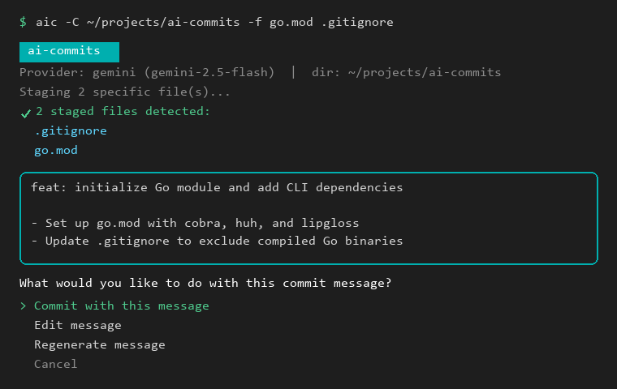

# AI Commits (`aic`) 🤖📝

Intelligent git commit message generator written in Go, powered by multiple AI providers.

<div>
  <div>
    
  </div>
</div>

## Key Features
- ⚡ **Single static binary** — Fast startup, zero runtime dependencies
- 🤖 **Multiple AI providers** — Gemini, OpenAI, DeepSeek, Groq, OpenRouter, and Ollama (local)
- 📁 **Target any directory (`-C` / `--dir`)** — Run against any repository path
- 📄 **Multi-file commits (`-f` / `--file`)** — Stage and commit one or more specific files without touching the rest of your staging area
- 📝 **Full multi-line commit support** — Uses `git commit -F -` via `stdin` (no shell escaping issues or message truncation)
- 🎨 **Interactive TUI** — Confirm, edit, regenerate with an optional hint, or cancel
- 🌍 **Multi-language** — `en`, `pt-BR`, and `es`
- 🔒 **Smart diff handling** — Automatically excludes noisy lockfiles (`package-lock.json`, `go.sum`, etc.) and truncates oversized diffs safely

## Installation

### Quick Install (without Go)

**Windows (PowerShell):**

```powershell
irm https://raw.githubusercontent.com/eliel-elie/ai-commits/main/install.ps1 | iex
```

**Linux / macOS:**

```bash
curl -fsSL https://raw.githubusercontent.com/eliel-elie/ai-commits/main/install.sh | sh
```

> Both scripts download the latest pre-built binary from GitHub Releases and add `aic` to your `PATH` (supports `amd64` and `arm64`).

### Build from source (Go 1.24+)

```bash
git clone https://github.com/eliel-elie/ai-commits.git
cd ai-commits
go build -o aic ./cmd/aic
# On Windows:
go build -o aic.exe ./cmd/aic
```

### Install directly with `go install`

```bash
go install github.com/eliel-elie/ai-commits/cmd/aic@latest
```

### Updating

Once installed, you can update `aic` directly from the binary (no Go or external tools required):

```bash
aic update          # Download and install the latest GitHub release
aic update --check  # Only check if a newer version is available
```

> By default, `aic` also checks silently at most once every 24 hours and notifies you if a newer version is available (set `AIC_NO_UPDATE_CHECK=1` to disable).

### Building Binaries (Windows & Linux)

You can compile binaries for both platforms from either Windows or Linux using `GOOS` and `GOARCH`.

**From Windows (PowerShell):**

```powershell
# Windows (64-bit)
$env:GOOS="windows"; $env:GOARCH="amd64"; go build -ldflags="-s -w" -o aic.exe ./cmd/aic

# Linux (64-bit)
$env:GOOS="linux"; $env:GOARCH="amd64"; go build -ldflags="-s -w" -o aic ./cmd/aic
```

**From Linux / macOS (Bash):**

```bash
# Linux (64-bit)
GOOS=linux GOARCH=amd64 go build -ldflags="-s -w" -o aic ./cmd/aic

# Windows (64-bit)
GOOS=windows GOARCH=amd64 go build -ldflags="-s -w" -o aic.exe ./cmd/aic
```

> Tip: For ARM64 targets (e.g. Raspberry Pi or ARM servers), use `GOARCH=arm64`.

## Configuration

Settings are loaded in order of precedence: **CLI flags > Environment variables > Local `.aicommits.json` > Global `~/.ai-commits`**.

```bash
# Set AI provider
aic config set provider gemini

# Set API key
aic config set gemini-key YOUR_API_KEY

# Optional settings
aic config set model gemini-2.5-flash
aic config set locale pt-BR
aic config set max-length 100
aic config set max-tokens 2048

# Inspect configuration (API keys are masked)
aic config list
aic config path
```

## Supported Providers

| Provider     | Default Model              | Config Key       | Environment Variable                     |
|--------------|----------------------------|------------------|------------------------------------------|
| `gemini`     | `gemini-2.5-flash`         | `GEMINI_KEY`     | `GEMINI_API_KEY` / `GEMINI_KEY`          |
| `openai`     | `gpt-5-mini`               | `OPENAI_KEY`     | `OPENAI_API_KEY` / `OPENAI_KEY`          |
| `deepseek`   | `deepseek-chat`            | `DEEPSEEK_KEY`   | `DEEPSEEK_API_KEY` / `DEEPSEEK_KEY`      |
| `groq`       | `llama-3.3-70b-versatile`  | `GROQ_KEY`       | `GROQ_API_KEY` / `GROQ_KEY`              |
| `openrouter` | `openai/gpt-4o-mini`       | `OPENROUTER_KEY` | `OPENROUTER_API_KEY` / `OPENROUTER_KEY`  |
| `ollama`     | `llama3.2`                 | —                | `base_url` (default `http://localhost:11434/v1`) |

## Usage

```bash
# Commit staged changes in the current directory
aic

# Stage all changes and commit
aic --all

# Stage and commit multiple specific files (space-separated or repeated -f)
aic -f cmd/aic/main.go internal/git/git.go
aic -f cmd/aic/main.go -f internal/git/git.go

# Target another repository directory
aic -C /path/to/repo --all

# Dry run (print generated message without committing)
aic --dry

# Skip interactive confirmation
aic --yes

# Give extra context to the AI
aic --hint "fixes issue #42"

# Override provider/model/locale for a single run
aic -p openai -m gpt-5-mini -l pt-BR

# Bypass git hooks
aic --no-verify
```

### Available Flags

| Flag | Short | Description |
|------|-------|-------------|
| `--dir` | `-C` | Target git repository directory (default `.`) |
| `--file` | `-f` | Specific file(s) to stage and commit (space-separated, e.g. `-f a.go b.go`) |
| `--all` | `-a` | Stage all changes before generating the commit message |
| `--dry` | `-d` | Generate and print the commit message without committing |
| `--yes` | `-y` | Skip interactive confirmation and commit immediately |
| `--no-verify` | | Bypass git `pre-commit` and `commit-msg` hooks |
| `--hint` | | Extra context or instructions for the AI |
| `--provider` | `-p` | Override AI provider |
| `--model` | `-m` | Override AI model |
| `--locale` | `-l` | Override locale (`en`, `pt-BR`, `es`) |
| `--max-length` | | Override target subject line length |
| `--exclude` | | Additional file patterns to exclude from diff |
| `--version` | `-v` | Show version |
